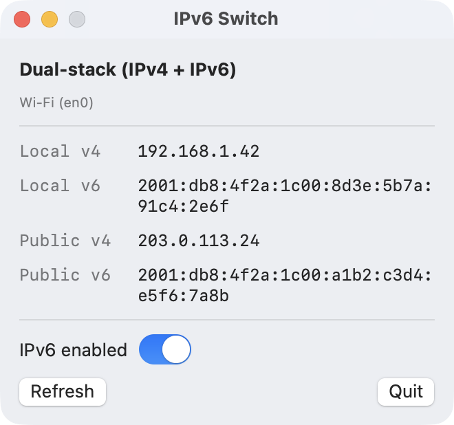

<div align="center">

# IPv6 Switch

**See whether your Mac is on IPv4, IPv6 or both, and turn IPv6 off with one switch.**

[](https://github.com/shubham-web/ipv6-switch/actions/workflows/ci.yml)
[](https://github.com/shubham-web/ipv6-switch/releases/latest)

[](LICENSE)

<picture>
  <source media="(prefers-color-scheme: dark)" srcset="docs/screenshot-dark.png">
  
</picture>

</div>

## Why

Some networks and services misbehave when your Mac uses IPv6:

- **Corporate tools, VPNs and single sign-on** that only allowlist IPv4 addresses, so requests that go out over IPv6 are blocked or flagged.
- **Sites and APIs with broken IPv6**, which load slowly or time out while IPv4 works fine.
- **IP-based access rules** that only know your IPv4 address.

The usual fix is to turn IPv6 off for your connection. On macOS that setting is buried in *System Settings → Network → Wi-Fi → Details → TCP/IP → Configure IPv6*. IPv6 Switch puts it one click away and shows what is actually going on.

## Features

- Shows your connection mode: **Dual-stack**, **IPv4 only**, **IPv6 only** or **No connectivity**
- Shows local and public IPv4 and IPv6 addresses (selectable, so you can copy them)
- Turns IPv6 off or back on for the network service you're using (Wi-Fi, Ethernet, USB adapters and so on)
- Works with full-tunnel VPNs by controlling the physical connection underneath
- Dock badge (`v4`, `v6`, `v4+v6`) so you can check at a glance
- Refreshes every 15 seconds
- Native SwiftUI, under 2 MB, no dependencies, no background helper, no telemetry

## Install

### Download

1. Download `IPv6-Switch-<version>.zip` from the [latest release](https://github.com/shubham-web/ipv6-switch/releases/latest).
2. Unzip it and drag **IPv6 Switch.app** to your Applications folder.
3. Open it. The app is not notarized by Apple yet, so macOS blocks the first launch. To allow it, go to *System Settings → Privacy & Security*, scroll down and click **Open Anyway**. Or run this in Terminal:

   ```sh
   xattr -dr com.apple.quarantine "/Applications/IPv6 Switch.app"
   ```

To verify the download, put the `.sha256` file from the release next to the zip and run `shasum -a 256 -c IPv6-Switch-<version>.zip.sha256`.

### Build from source

You need macOS 13 or later and Swift 6, which comes with Xcode 16+ or the Command Line Tools (`xcode-select --install`).

```sh
git clone https://github.com/shubham-web/ipv6-switch.git
cd ipv6-switch
make install        # builds the app and copies it to /Applications
```

macOS doesn't show the Gatekeeper warning for apps you build yourself. Other useful targets are `make run`, `make test` and `make zip`. `make help` lists them all.

## Usage

1. Open **IPv6 Switch**. The header shows your current mode and the line below it shows which network service the switch controls, such as `Wi-Fi (en0)`.
2. Turn **IPv6 enabled** off. macOS asks for an administrator password, because changing network settings needs one. The app refreshes after a few seconds.
3. Turn it back on to restore IPv6. This sets it to *Automatic*, the macOS default.

The change is saved in your macOS network settings for that service, so **it stays off after a restart** until you switch it back. If you only need IPv6 off on one network (at work, say), remember to turn it back on when you leave.

## How it works

There's no magic. The app runs the same commands you could run yourself:

| Step | Command |
| --- | --- |
| Find the interface carrying internet traffic | `route -n get default` |
| Map that interface to a network service | `networksetup -listnetworkserviceorder` |
| Check whether IPv6 is on | `networksetup -getinfo "<service>"` |
| Turn IPv6 off or on | `networksetup -setv6off "<service>"` or `networksetup -setv6automatic "<service>"` |
| Read local addresses | `getifaddrs(3)` |
| Look up public addresses | HTTPS requests to `api4.ipify.org` (IPv4 only) and `api6.ipify.org` (IPv6 only) |

When `networksetup` needs root, the app asks through the standard macOS administrator dialog (AppleScript's `do shell script … with administrator privileges`). Only that one `networksetup` command runs as root. The service name is passed as an argument and shell-quoted, never pasted into the script. Nothing is installed, and nothing keeps running with elevated privileges.

The code is small. Start with [`NetworkSnapshot.swift`](Sources/IPv6SwitchCore/NetworkSnapshot.swift) and [`IPv6Control.swift`](Sources/IPv6SwitchCore/IPv6Control.swift).

## Privacy

The only network requests the app makes are to [ipify](https://www.ipify.org) (`api4.ipify.org` and `api6.ipify.org`), every 15 seconds while it's open, to look up your public addresses. ipify sees your IP addresses, as any website does. These requests skip the system proxy so they reflect your Mac's own connectivity.

There are no analytics, no telemetry, no accounts, and nothing is written to disk.

## Limitations

- **macOS only for now.** Windows support is planned if there's demand. [Open or upvote an issue](https://github.com/shubham-web/ipv6-switch/issues) if you'd use it.
- Turning IPv6 back on sets it to *Automatic*. If you had configured IPv6 manually, re-enter your settings in System Settings.
- The switch controls one service: the one carrying your internet traffic. Use System Settings for the others.
- If a firewall blocks ipify, *Public v4/v6* shows `none` even when you're connected. The mode in the header also uses your local addresses, so it stays accurate.
- Release builds aren't notarized yet, so macOS warns on first launch (see [Install](#download)).

## Troubleshooting

**The switch is greyed out, or it says "No network service".** The app couldn't match your connection to a macOS network service. Please [open an issue](https://github.com/shubham-web/ipv6-switch/issues/new/choose) and include the output of these two commands (redact anything you consider private):

```sh
route -n get default
networksetup -listnetworkserviceorder
```

**I turned IPv6 off but an app still uses it.** Some apps keep connections open. Reconnect your VPN or restart the app. You can confirm the setting in *System Settings → Network → (your service) → Details → TCP/IP*.

**I want to do it from the command line.** `networksetup -setv6off Wi-Fi` and `networksetup -setv6automatic Wi-Fi`, with `sudo` if needed.

## Uninstall

If you turned IPv6 off, turn it back on first. Then delete **IPv6 Switch.app**. The app stores nothing else on your Mac.

## Roadmap

Ideas that would make good contributions:

- [ ] Windows version
- [ ] Menu bar mode (no Dock icon)
- [ ] Launch at login
- [ ] Notarized releases and a Homebrew cask
- [ ] Optional per-network rules (for example, IPv6 off only on the office Wi-Fi)

## Contributing

Bug reports, ideas and pull requests are welcome. See [CONTRIBUTING.md](CONTRIBUTING.md) for how to build, test and submit changes. To report a security problem, follow [SECURITY.md](SECURITY.md) instead of opening a public issue.

## License

[MIT](LICENSE)
